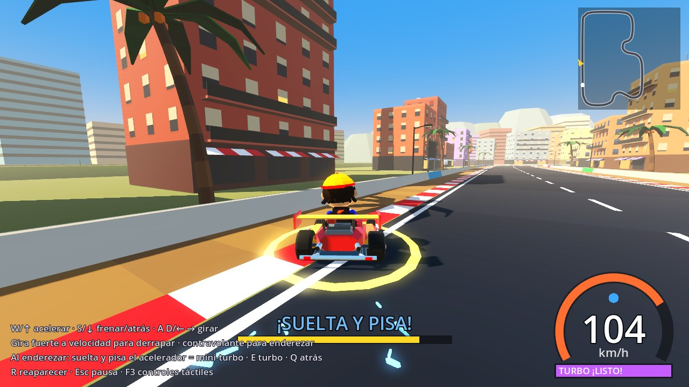
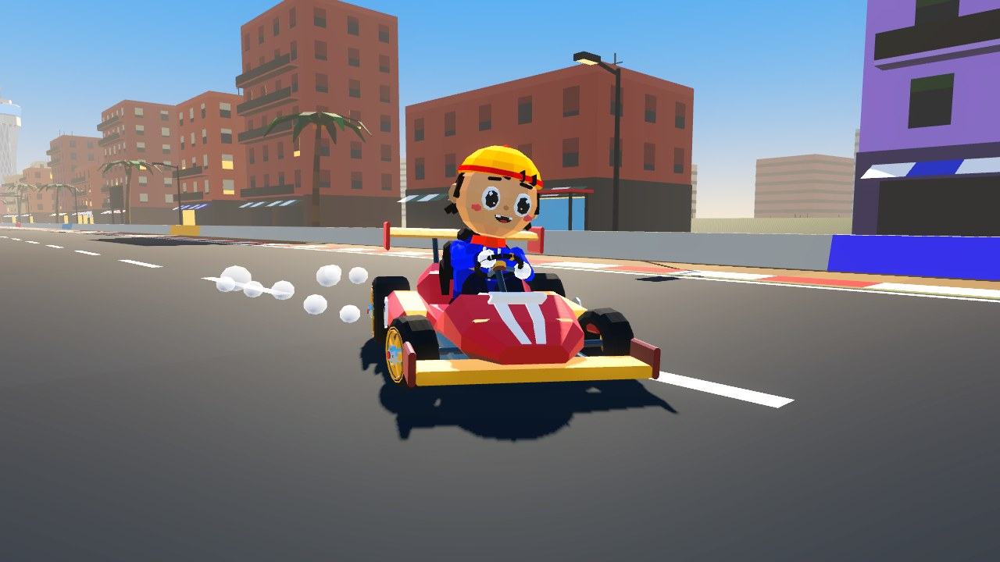
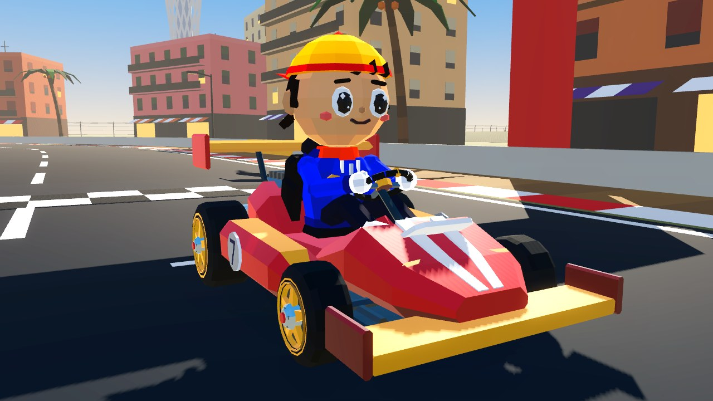
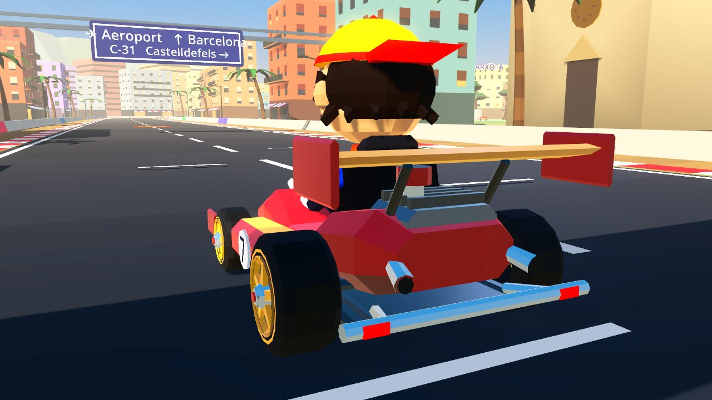
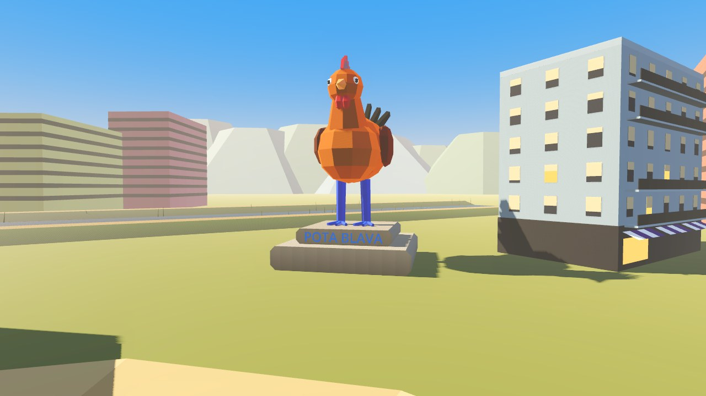
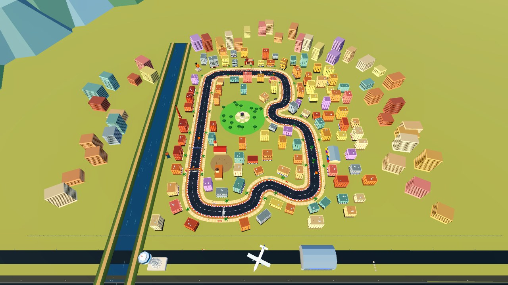

# Super Barrio Kart 3D

Arcade de karts **poligonal** para **PC y Android**, hecho con **Godot 4** y **GDScript**.
Proyecto independiente que sucede a *Super Barrio Kart v16* (2D): mismo concepto, ambiente
urbano y circuito de **El Prat de Llobregat**, ahora en 3D real.

> **Versión 0.5.0:** el mini-turbo sale al volver a acelerar tras el derrape (suelta el gas
> cuando quieras durante el derrape y pisa al salir) y el impulso se nota mucho más.
>
> **Versión 0.4.0:** derrape más accesible (gira de golpe o pásate de giro, también en recta)
> y arreglado el fallo que lanzaba el kart por los aires al atropellar un cono.
>
> **Versión 0.3.0: derrape natural.** Sin botón de derrape: el kart derrapa al perder
> adherencia y el mini-turbo se gana enderezando y soltando y pisando el acelerador
> ([`docs/DERRAPE.md`](docs/DERRAPE.md)).
>
> 
>
> **Versión 0.2.0.** Un circuito, un kart y un piloto, ya pulidos: conducción con derrape
> progresivo y contravolante, modelos 3D rehechos, iluminación nueva y un El Prat con
> lugares reconocibles. Todavía no hay rivales, ni objetos ni el resto de personajes.
> Novedades en [`docs/MEJORAS_v0.2.md`](docs/MEJORAS_v0.2.md).



**📱 Android:** descarga el APK de prueba en
[Releases → apk-prueba](https://github.com/Erre84/Super-Barrio-Kart-3D./releases/tag/apk-prueba)
y sigue [`docs/ANDROID.md`](docs/ANDROID.md).

## Qué incluye

| | |
|---|---|
| **Kart low-poly** | Carrocería esculpida con chaflanes, alerones, motor y escapes cromados, volante que gira y ruedas con llanta de 5 radios, flanco de color y pinza de freno. Materiales separados: pintura, goma, metal, cromo. |
| **Piloto chibi** | Cabeza grande con ojos expresivos que parpadean, gorra hacia atrás, sudadera, bufanda que ondea y brazos que siguen al volante. Sonríe al derrapar y se gira al mirar atrás. |
| **Circuito "El Prat"** | ~1 km con curva de 90°, calle en obras, chicane, avinguda con isletas y una "ese". Gallina Pota Blava, La Telegrafia, chimenea del Parc del Riu y río Llobregat, Casa de la Vila y parroquia, Mercat, Plaça de la Carxofa y aeropuerto con torre de control, pista y aviones aterrizando y despegando. |
| **Conducción arcade** | Aceleración, frenada, marcha atrás, derrape progresivo con contravolante, mini-turbos (azul → naranja → morado), turbo, pads aceleradores, salida perfecta. |
| **Sin ayudas** | La dirección solo responde a tu entrada: nada gira el kart por ti ni frena antes de las curvas (comprobado por pruebas automáticas). |
| **Efectos** | Humo 3D, chispas por nivel con destello, llamas de turbo, polvo, sombra de contacto, suspensión que rebota y vibración de cámara al chocar. |
| **Colisiones** | Muros New Jersey, isletas, barreras de obra y bolardos (fijos), conos que salen volando. Salirse al arcén de tierra frena. |
| **Cámara** | Tercera persona detrás del kart, FOV dinámico, botón para **mirar atrás**. |
| **Controles** | Teclado, mando y pantalla táctil multitáctil (Android). |
| **HUD** | Velocímetro, vuelta X/3, cronómetro, mejor vuelta, barra de turbo, nivel de mini-turbo, minimapa, cuenta atrás, pausa. |
| **Renderizador** | `Compatibility` (OpenGL 3 / OpenGL ES 3): funciona en casi cualquier PC y móvil. |

| | |
|---|---|
|  |  |
|  |  |

## Cómo ejecutarlo

1. Instala **Godot 4.5** (versión estándar, no hace falta la de .NET): <https://godotengine.org/download>
2. Abre Godot → **Importar** → selecciona `project.godot` de este repositorio.
3. Pulsa **F5** (o el botón ▶ "Ejecutar proyecto").

La primera vez Godot tarda unos segundos en importar. No hay recursos que descargar: toda la
geometría se genera al arrancar.

Desde terminal:

```bash
godot --path .                     # jugar
GODOT=godot ./tools/run_tests.sh   # pruebas automáticas
godot --path . -- --touch          # jugar mostrando los controles táctiles en PC
```

## Controles

| Acción | Teclado | Mando (Xbox / PlayStation) | Táctil |
|---|---|---|---|
| Acelerar | `W` / `↑` | `A` / `✕` o gatillo `RT` / `R2` | ACEL |
| Frenar / marcha atrás | `S` / `↓` | `B` / `○` o gatillo `LT` / `L2` | FRENO |
| Girar | `A` `D` / `←` `→` | Stick izquierdo (analógico) o cruceta | ◀ ▶ |
| Turbo | `E` / `Espacio` | `X` / `□` o `RB` / `R1` | TURBO |
| Mirar atrás | `Q` / `C` | `Y` / `△` | ATRÁS |
| Reaparecer en pista | `R` | `Back` / `Select` | — |
| Pausa | `Esc` / `P` | `Start` | II |
| Mostrar/ocultar controles táctiles | `F3` | — | — |

En Android los controles táctiles aparecen solos. En PC puedes activarlos con `F3` y usarlos
con el ratón para probarlos. Las teclas usan la posición física, así que funcionan igual con
teclado español, francés, etc.

### Cómo se conduce

- **Girar** solo hace lo que tú indicas. A más velocidad el giro es algo menos brusco, pero
  nunca hay corrección automática.
- **Derrape natural (sin botón):** con un giro normal el kart agarra; si **giras de golpe** o
  **un poco más de la cuenta** (a partir de ~50 km/h, también en recta), las ruedas pierden
  agarre y el kart se cruza. Mantén el volante para
  sostenerlo (azul → naranja → morado) y **contravolantea** para enderezar.
- **Mini-turbo:** suelta el gas en algún momento del derrape y **vuelve a acelerar** al salir:
  ¡impulso! (si no habías soltado, al quedar recto aparece "¡SUELTA Y PISA!"). Se encadena.
  Guía completa: [`docs/DERRAPE.md`](docs/DERRAPE.md).
- **Turbo:** la barra se recarga sola (≈9 s) y los mini-turbos la rellenan un poco.
- **Salida perfecta:** acelera justo cuando la cuenta atrás va a llegar a 0.
- **Pads naranjas** con flechas: aceleradores.
- Salirse a la **tierra** del arcén frena mucho; los **muros** frenan según lo frontal del golpe.

## Estructura del proyecto

```
project.godot              Configuración (renderer Compatibility, 1280x720, horizontal)
export_presets.cfg         Presets de exportación: Android, Windows, Linux
scenes/
  main.tscn                Escena principal (carrera)
  kart.tscn                Kart del jugador (CharacterBody3D)
  track_el_prat.tscn       Circuito de El Prat
  hud.tscn                 Interfaz
materials/                 Materiales low-poly (color por vértice, luminoso, partículas)
scripts/
  core/input_setup.gd      Mapa de controles (teclado + mando) registrado por código
  core/mesh_builder.gd     Generador de mallas low-poly facetadas
  kart/kart.gd             Física arcade: adherencia, derrape natural, mini-turbo, choques
  kart/kart_audio.gd       Sonido sintetizado: motor, chirrido, avisos, impulso
  kart/kart_model.gd       Modelo 3D del kart y del piloto chibi + animaciones
  kart/kart_effects.gd     Humo, chispas, llamas, polvo y sombra de contacto
  kart/chase_camera.gd     Cámara trasera y "mirar atrás"
  track/track_el_prat.gd   Trazado, asfalto, muros, obstáculos, ciudad
  track/props.gd           Edificios, palmeras, farolas, alcachofa, avión...
  track/landmarks.gd       Lugares de El Prat: Pota Blava, Telegrafia, aeropuerto...
  track/airplane.gd        Aviones aterrizando y despegando
  ui/hud.gd                Velocímetro, vueltas, minimapa, pausa
  ui/touch_controls.gd     Botones táctiles multitáctiles
  game/race.gd             Lógica de carrera
  game/lighting.gd         Iluminación, sombras, niebla y brillo
tests/
  physics_tests.gd         Pruebas de física (dirección, derrape, muros, conos...)
  autopilot.gd             Piloto automático para pruebas (usa las acciones reales)
  showcase.gd              Capturas de presentación
tools/run_tests.sh         Ejecuta todas las pruebas
docs/PRUEBAS.md            Qué se ha probado, resultados y lista para probarlo tú
docs/MEJORAS_v0.2.md       Qué ha mejorado en la v0.2 y qué sigue pendiente
docs/ANDROID.md            Cómo instalar el APK de prueba
docs/DERRAPE.md            Técnica de derrape y mini-turbo, parámetros y valores medidos
.github/workflows/         Pruebas automáticas y compilación del APK en GitHub Actions
```

### Por qué la geometría se genera por código

Los modelos (kart, piloto, edificios, palmeras...) se construyen con `mesh_builder.gd` a partir
de primitivas facetadas con color por vértice. Son mallas 3D reales (`ArrayMesh`), con
sombras e iluminación, pero así esta primera versión no depende de archivos de Blender, pesa
muy poco y cada pieza se puede retocar cambiando números. Cuando haya diseños definitivos se
pueden sustituir por modelos `.glb` sin tocar la física.

### Retocar cosas

- **Manejo:** parámetros exportados en `scripts/kart/kart.gd` (velocidad, agarre, giro,
  derrape, turbo).
- **Trazado:** mueve los puntos de `CONTROL_POINTS` en `scripts/track/track_el_prat.gd`;
  asfalto, muros, bordillos, aceras y edificios se regeneran solos.
- **Colores del kart y del piloto:** diccionario `style` en `scripts/kart/kart_model.gd`.

## Exportar a Android

El APK de prueba se compila solo en GitHub (ver arriba). Para hacerlo tú:

1. En Godot: **Editor → Administrar plantillas de exportación** → descargar.
2. Instala el SDK de Android y configura su ruta en **Editor → Configuración del editor →
   Exportar → Android** ([guía oficial](https://docs.godotengine.org/es/4.x/tutorials/export/exporting_for_android.html)).
3. **Proyecto → Exportar → Android** (el preset ya está creado: arm64, pantalla completa,
   horizontal). Para probar rápido con el móvil conectado por USB usa el botón de
   *despliegue en un clic* de la barra superior del editor.

## Hoja de ruta (siguientes entregas)

- Adaptar los diseños de los personajes de *Super Barrio Kart v16* (esta versión usa un
  piloto provisional; los colores están centralizados para cambiarlo).
- Rivales con IA, posiciones y parrilla completa.
- Objetos/poderes del barrio.
- Sonido y música.
- Más tramos de El Prat y menú principal.
