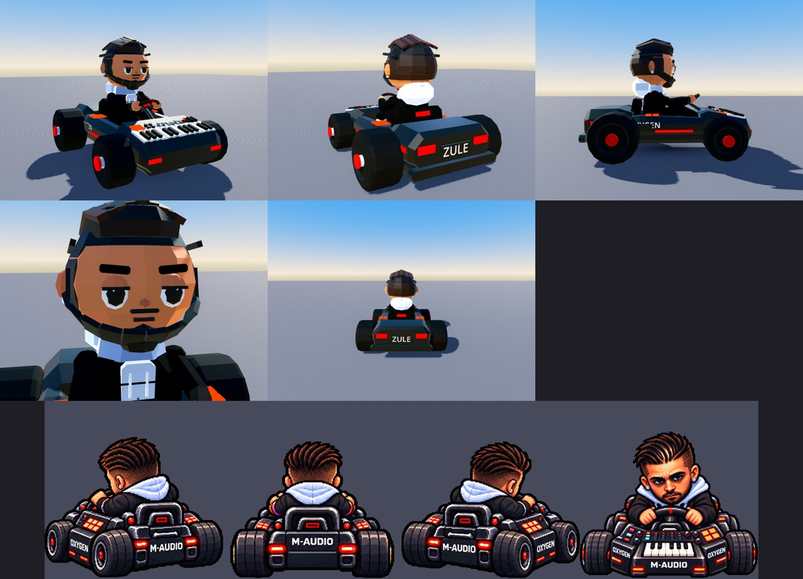
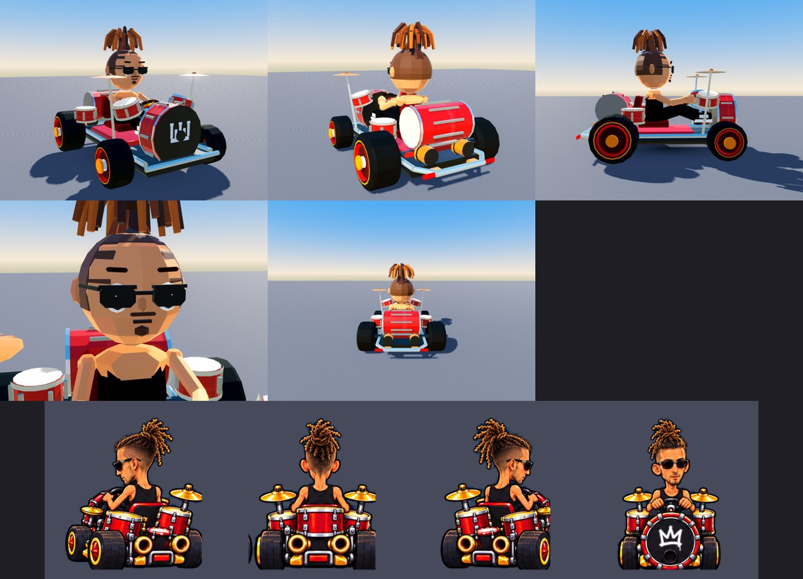
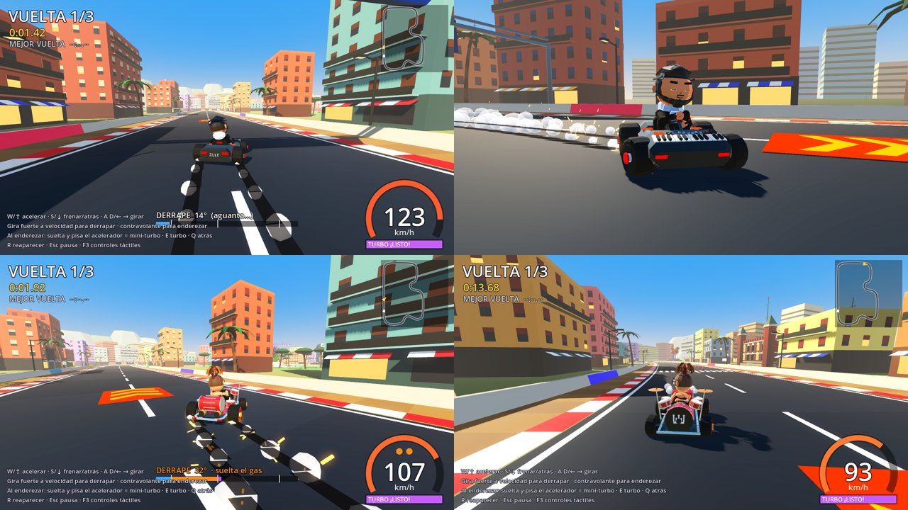
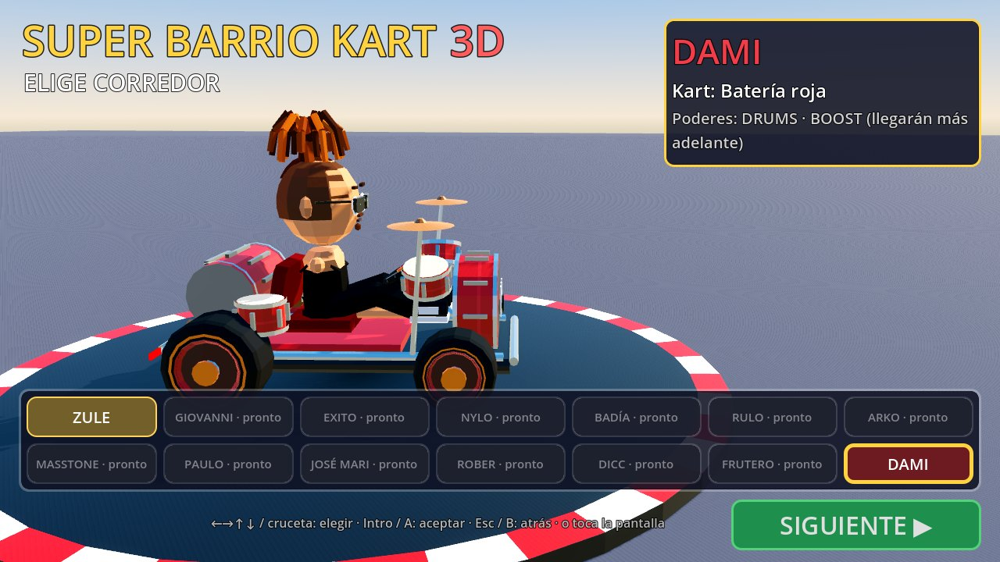
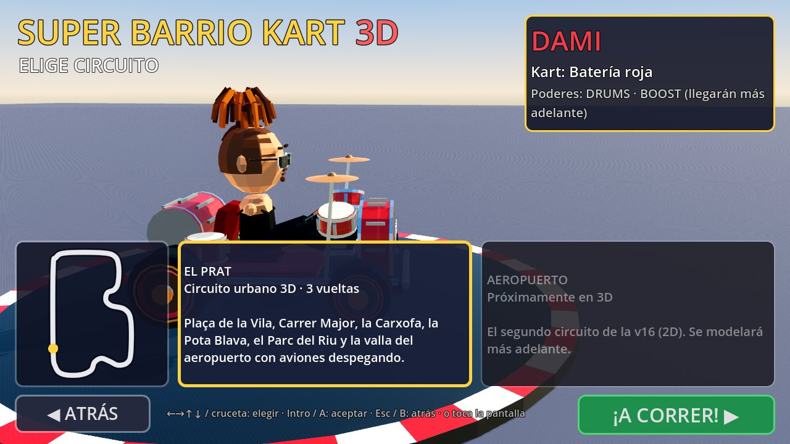

# Corredores en 3D (v0.7)

Los 14 corredores de *Super Barrio Kart v16.3* pasan a 3D poligonal, uno a uno, a partir de
sus diseños originales: los sprites del juego (`racers-v3.png` y `new_racers_v163.png`,
vistas rear0/rear1/rear2/front) y las láminas aprobadas de cada personaje.

| Zule · Oxygen Kart | Dami · Batería roja |
|---|---|
|  |  |

Arriba, el modelo 3D (frente, detrás, perfil, cara y vista de conducción); abajo, los
sprites originales de la v16 con los que se compara.



| Menú: elige corredor | Menú: elige circuito |
|---|---|
|  |  |

## Estado

| N.º | Corredor | Kart | Estado 3D |
|---|---|---|---|
| 1 | ZULE | Oxygen Kart (teclado MIDI) | **Modelado** |
| 2 | GIOVANNI | Kart Lakers 24 | Pendiente |
| 3 | EXITO | Spray Kart | Pendiente |
| 4 | NYLO | Hueso largo | Pendiente |
| 5 | BADÍA | Mando PS1 | Pendiente |
| 6 | RULO | Micrófono Shure | Pendiente |
| 7 | ARKO | Hoja de marihuana | Pendiente |
| 8 | MASSTONE | TONE · Libro alado | Pendiente |
| 9 | PAULO | Bandera de Chile | Pendiente |
| 10 | JOSÉ MARI | Kart azulgrana (Barça) | Pendiente |
| 11 | ROBER | Bolígrafo azul | Pendiente |
| 12 | DICC | Diamante | Pendiente |
| 13 | FRUTERO | Gorra Ecko | Pendiente |
| 14 | DAMI | Batería roja | **Modelado** |

En el menú, los pendientes aparecen como "pronto" y no se pueden elegir todavía.

### Zule · Oxygen Kart
- **Kart:** carrocería compacta negra brillante; en el morro, un teclado MIDI inclinado hacia
  el piloto con 14 teclas blancas y sus negras, ruedas de pitch/mod, botones azules y rojos,
  pantalla roja "127", faders y potenciómetros; pads naranjas 2×2 en el teclado y en los
  pontones; pilotos rojos rectangulares, emblema rojo en el respaldo; ruedas negras anchas
  con buje rojo.
- **Piloto:** chaqueta negra acolchada abierta sobre la sudadera blanca-azulada, con la
  capucha voluminosa a la espalda; tupé castaño peinado hacia atrás con surcos y degradado
  en los lados; barba recortada; pendientes brillantes; mirada seria de párpado caído.

### Dami · Batería roja
- **Kart:** bombo delantero con parche negro, aro rojo, tensores cromados y la corona
  blanca; toms rojos a los lados; dos platillos dorados en sus soportes; tom grande
  atravesado detrás del asiento y toms traseros; dos escapes dorados redondos; chasis
  tubular cromado; ruedas negras con llanta roja y aro dorado.
- **Piloto:** complexión muy delgada (brazos finos y cabeza algo más pequeña), camiseta
  de tirantes negra, vaqueros anchos, zapatillas negras y blancas, gafas de sol, rastas
  rubias recogidas en una coleta alta con los lados rapados, perilla y bigote finos.

### Marcas registradas
Los logotipos y nombres de marcas reales que aparecen en algunas láminas (teclado, equipos
deportivos, consola, ropa) **no se reproducen** en los modelos: se conserva todo lo demás del
diseño (forma, colores, números, objetos) y, donde iba la marca, va el nombre del corredor o
del kart (por ejemplo, "ZULE" en la placa trasera y "OXYGEN" en los laterales).

## Cómo está hecho

- `scripts/racers/roster.gd`: los 14 corredores (nombre, kart, colores y poderes de la v16.3).
- `scripts/kart/kart_model.gd`: **esqueleto común** (suspensión, ruedas que giran y
  viran, volante, brazos que lo siguen, cabeza que mira a la curva y hacia atrás, parpadeo,
  expresión al derrapar). Cada corredor lo hereda y redefine:
  - `_setup_style()`: colores, complexión (`arm_scale`, `head_scale`), cara (`eye_size`,
    `eye_lid`, `brow_*`, `mouth`, `beard`, `earring`, `blush`...), ruedas (`rim_style`,
    `front_wheel`/`rear_wheel`...).
  - `_build_chassis()`: el kart.
  - `_build_legs()`, `_build_shoe()`, `_build_torso()`: la ropa.
  - `_build_head_shape()`, `_build_hair()`, `_build_head_extras()`: cabeza, peinado y
    accesorios (gafas, gorras...).
- `scripts/racers/<id>.gd`: un archivo por corredor. Con que exista, el corredor queda
  disponible en el menú.
- **La física es la misma para todos** (como en la v16: carrera justa). El corredor solo
  cambia el modelo; el derrape y el mini-turbo de la v0.6.3 no se han tocado (la suite de
  física da exactamente los mismos resultados y la misma vuelta: 39,3 s).

## Rendimiento (Android)

Medido con `tests/perf_karts.gd` en la parrilla de El Prat con la calidad de móvil
(cámara de carrera). Las llamadas de dibujo y los triángulos no dependen del hardware;
el tiempo de fotograma del servidor (sin GPU) no es representativo de un móvil.

| Escena | Llamadas de dibujo | Triángulos |
|---|---|---|
| Solo el circuito | 79 | 288 000 |
| + 1 kart del piloto provisional de la v0.6.3 (antes de optimizar) | 225 | 310 000 |
| + 1 kart de la v0.7 (Zule o Dami) | 130 | 307 000 |
| + 8 karts de la v0.7 | 438 | 431 000 |

Cada corredor tiene unos 7.500-8.400 triángulos. Para que quepan varios en pantalla:
- Todas las piezas fijas del kart se unen en una sola malla (una superficie por material).
- Ruedas, cabeza, cuerpo, manos, ojos y bocas son de una sola superficie cada uno.
- Solo proyectan sombra la carrocería, el cuerpo, la cabeza y las ruedas.
- Ojos, cejas, boca y rótulos dejan de dibujarse a más de 45 m.

Un kart de la v0.7 cuesta un 65 % menos llamadas de dibujo que el kart de la v0.6.3,
con más detalle. **Pendiente de comprobar en un móvil real** (FPS).

## Herramientas

```bash
# Fotos de estudio de los corredores (frente, detrás, perfil, cara, conducción)
xvfb-run godot --path . --resolution 960x720 -s res://tests/racer_gallery.gd -- --out=/tmp/galeria --racers=zule,dami
# Coste de render con 1 y 8 karts
xvfb-run godot --path . --resolution 1280x720 -s res://tests/perf_karts.gd -- --racers=zule,dami --count=8
# Captura del menú
xvfb-run godot --path . --resolution 1280x720 -- --menu-shot=/tmp/menu.png [--menu-step=1] [--menu-racer=dami]
# Carrera directa con un corredor (sin menú)
godot --path . -- --race --racer=dami
```
