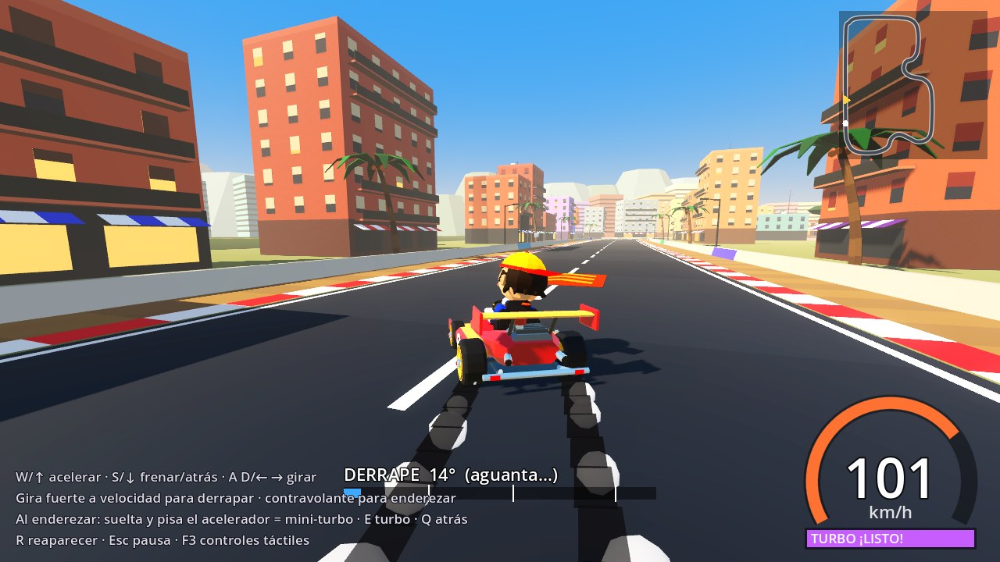
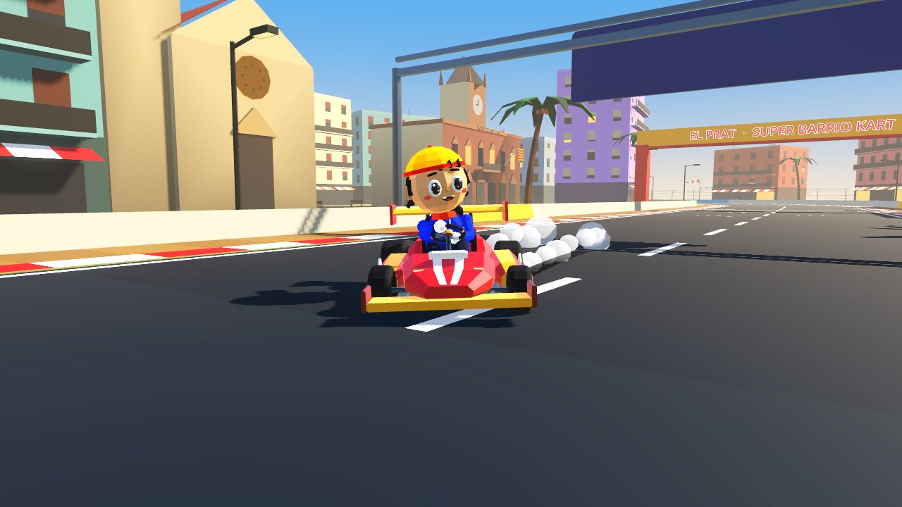
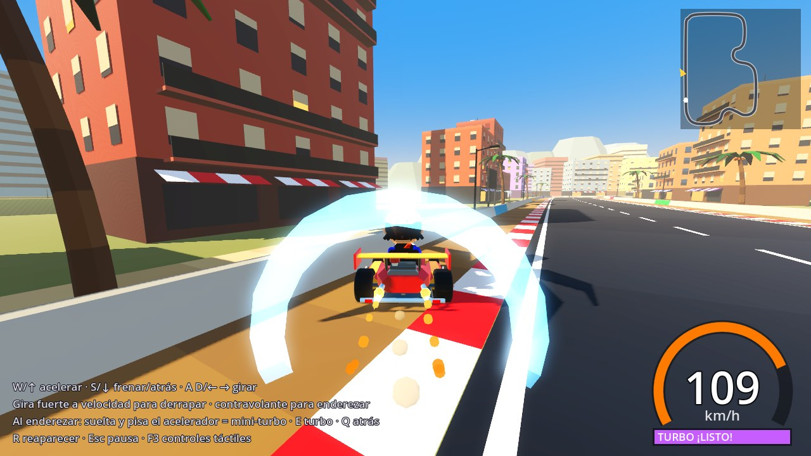
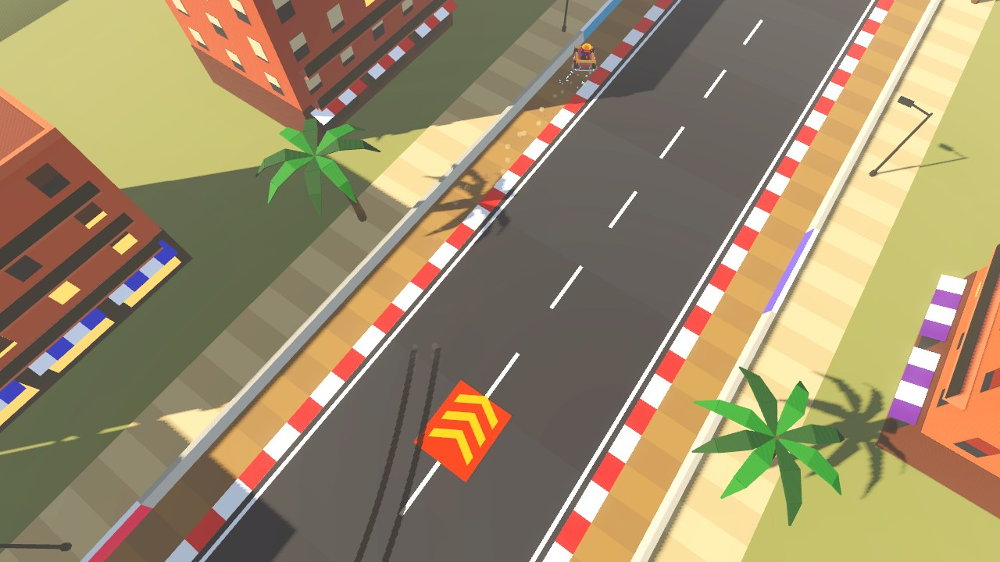

# Derrape natural y mini-turbo (v0.3)

No hay botón de derrape. El kart derrapa cuando sus neumáticos **no pueden dar la fuerza
lateral que pide el giro**, esté donde esté: en una curva, en plena recta o al esquivar algo.

| Derrape en recta | Visto de frente |
|---|---|
|  |  |
|  |  |

## Zigzag en recta (v0.6)

En una recta a buena velocidad, **gira de un lado a otro pasándote un poco** (≈70 % de volante,
cambiando de lado cada medio segundo). En cada cambio, **suelta el gas y vuelve a pisar**:
el kart derrapa a un lado, luego al otro, y cada derrape suelta su mini-turbo. Medido sin
corregir la trayectoria: 8 derrapes y 7 mini-turbos seguidos. Yendo lento no derrapa
(a 50 km/h hace falta girar casi a fondo).

El **mini-turbo es un empuje parejo**, no un tirón: sube unos 7 km/h por décima de segundo
hasta 116 / 122 / 127 km/h (según el nivel) durante 1,0 / 1,3 / 1,6 s y se apaga suave.
En la v0.5 subía hasta 38 km/h de golpe en una décima y llegaba a 136-144 km/h.

## Cómo se hace (v0.4: más accesible)

El derrape **lo provocas tú**: con un giro normal el kart agarra y traza preciso; si
**giras de golpe** o **un poco más de lo que pide la curva** (también en plena recta), las
ruedas pierden agarre y el kart se cruza.

**Cuándo derrapa** (medido con `tests/drift_ease_map.gd`: medio segundo de giro y luego
contravolante). · = agarra, D = derrapa, **T = derrapa y da opción a mini-turbo**:

| Velocidad | 40 % volante | 55 % | 70 % | 85 % | 100 % |
|---|---|---|---|---|---|
| 50 km/h | · | · | · | D | **T** |
| 65 km/h | · | · | D | **T** | **T** |
| 80 km/h | · | · | **T** | **T** | **T** |
| 104 km/h | · | D | **T** | **T** | **T** |

En la v0.3 solo la esquina inferior derecha (volante a fondo a 104 km/h) daba "T".

1. **Provoca el derrape.** Gira más de la cuenta o da un volantazo. En móvil: lleva el pulgar
   al **borde exterior** del botón ◀ o ▶. El centro del botón es un giro normal (~55 %) y el
   borde interior, un giro suave. Frenar mientras giras también lo cruza.
2. **Aguántalo un momento.** Basta con **0,15 s** para que cuente (v0.6). La barra de
   derrape se llena: **azul** (0,15 s) → **naranja** (0,6 s) → **morado** (1,2 s).
3. **Contravolantea para enderezar.** Gira hacia el otro lado: se endereza en ~0,85 s.
   Soltando el volante también se recupera, pero tarda unos 2 s.
4. **Suelta el gas y vuelve a acelerar (v0.5).** En algún momento del derrape (mientras
   derrapas, al contravolantear o al quedar recto) **suelta el acelerador**: el indicador
   pasa a "¡endereza y PISA!" (turbo cargado). Al **volver a pisar** cuando el kart ya está
   saliendo del derrape (menos de 16° de cruce): **¡MINI-TURBO!** Si no habías soltado, al
   quedar recto aparece "¡SUELTA Y PISA!" y tienes 1,2 s para hacerlo.
   - El impulso (v0.6) empuja de forma constante hasta 116 / 122 / 127 km/h según el nivel,
     durante 1,0 / 1,3 / 1,6 s. Se nota aunque salgas lento del derrape: de 60 a 127 km/h.

**Encadenar.** Después de un mini-turbo puedes provocar otro enseguida, también en recta:
volantazo a un lado → contravolante → suelta y pisa → volantazo al otro…

### Qué NO funciona (a propósito)

| Intento | Resultado |
|---|---|
| Machacar el acelerador sin derrapar | Nada: sin derrape válido no hay ventana |
| Machacar el acelerador durante la ventana | Un solo mini-turbo: cada derrape da **un** intento |
| Golpe de volante muy corto (~0,13 s) | No llega a ser derrape válido: no abre ventana |
| No soltar nunca el acelerador | Sin impulso: hay que soltar y volver a pisar |
| Pisar cuando ya pasó la ventana | Sin impulso |
| Cruzarse más de 85° (trompo) | Derrape anulado |
| Chocar fuerte contra un muro derrapando | Derrape anulado |
| Quedarse lento derrapando | Derrape anulado |

## Señales

- **Chirrido** de neumáticos que crece con la deriva: empieza suave al perder agarre y
  chilla en derrape pleno. También al frenar fuerte.
- **Humo** más denso cuanto más cruzado vas.
- **Marcas de goma** en el asfalto. Se quedan durante la carrera, hasta 700 tramos.
- **Chispas** del color del nivel (azul / naranja / morado).
- **Indicador** en pantalla con la deriva en grados y la barra de nivel.
- **Ventana**: campanita, texto "¡SUELTA Y PISA!" con barra de tiempo y anillo amarillo.
- **Mini-turbo**: sonido de impulso, onda expansiva del color del nivel, llamas, golpe de
  cámara y texto.
- **Fallo**: sonido grave corto y un aviso que explica qué ha pasado.

## Física (para ajustar)

Todo está en el inspector del nodo `Kart` (`scripts/kart/kart.gd`):

- **Dirección**: `turn_speed`, `high_speed_steer`, `yaw_response` (con agarre),
  `yaw_response_slide` (inercia del giro al deslizar), `slide_steer` (autoridad del
  volante deslizando, incluido el contravolante).
- **Adherencia**: `grip_peak` (m/s² de aceleración lateral con agarre), `grip_slide`
  (agarre dinámico: más bajo = más inercia lateral), `slip_peak_deg` / `slip_full_deg`
  (forma de la curva de agarre), `slide_min_speed`, `oversteer` y `drift_angle_target`
  (tendencia a cruzarse y ángulo de equilibrio), `flick_grip_loss` /
  `flick_sensitivity` (volantazos), `brake_grip_loss`, `slide_drag`.
- **Mini-turbo**: `drift_enter_deg`, `drift_recover_deg`, `drift_recover_hold`,
  `drift_spin_deg`, `drift_min_time`, `drift_level_times`, `mini_turbo_time`,
  `mini_turbo_speed` (punta por nivel), `mini_turbo_accel` (fuerza del empuje constante),
  `mini_turbo_kick` (empujón instantáneo, pequeño), `boost_fade` (lo suave que se apaga),
  `boost_fire_deg` (cruce máximo al pisar), `boost_window`, `lift_min`.

**Cómo funciona por dentro.** Cada fotograma:
1. La velocidad de giro sigue al volante con inercia.
2. Al girar, la velocidad conserva su dirección, así que aparece **velocidad lateral local**.
3. Los neumáticos la anulan hasta su límite de agarre. Ese límite depende del ángulo de
   deriva: es máximo hasta 4° y cae al agarre dinámico a partir de 14°.
4. Si el giro pide más, la deriva crece de forma progresiva.
5. Mientras desliza, el kart tiende a cruzarse hasta un ángulo de equilibrio, y el
   contravolante lo devuelve.

**Garantías.** No hay ningún código que gire, enderece o frene el kart por el jugador, ni
derrapes preprogramados: todo sale de esas fuerzas. Las pruebas automáticas lo comprueban.

## Valores medidos (pruebas automáticas, v0.4)

| Situación | Resultado |
|---|---|
| Giro normal (40 %) a 104 km/h | agarra (1,6° de deriva) |
| Pasarse de giro (75 %) en recta | derrapa (22°) |
| Volantazo a fondo en recta a 104 km/h | derrapa desde 0,23 s, hasta 31° y 15 m/s laterales |
| Pérdida de agarre | progresiva: 9° → 22° → 31° en 0,25 / 0,5 / 0,75 s (máx. 0,9° por fotograma) |
| Volante a fondo a 22 km/h | no derrapa |
| Volante a fondo sostenido | derrape estable entre 35° y 41° durante 2 s, sin trompo |
| Enderezar con contravolante / soltando el volante | 0,85 s / 2,0 s |
| Frenar a fondo derrapando | trompo (92°) y derrape anulado |
| Izquierda frente a derecha | idéntico (diferencia 0,000°) |
| Machacar el acelerador 3 s sin derrapar | 0 mini-turbos |
| Encadenar en recta (der → izq → der) | 3 mini-turbos seguidos |
