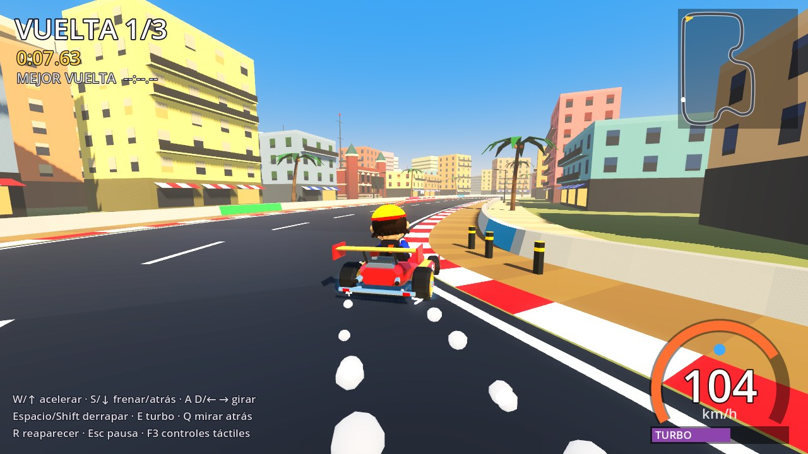
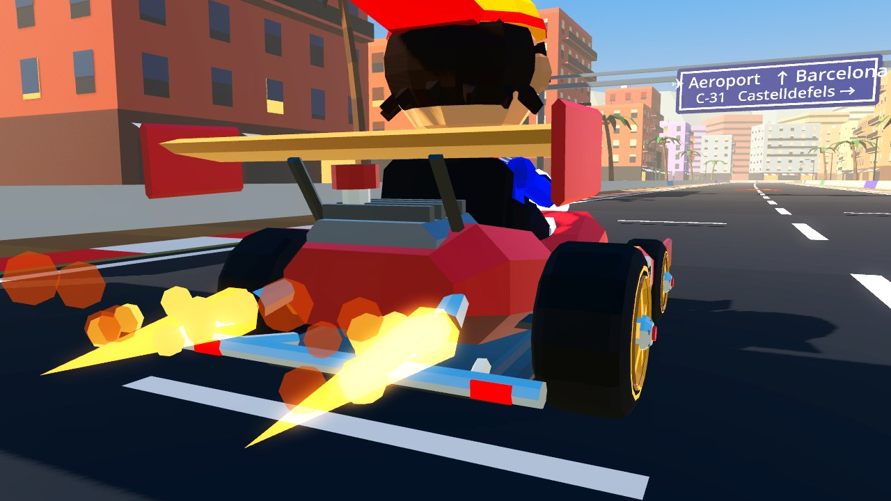
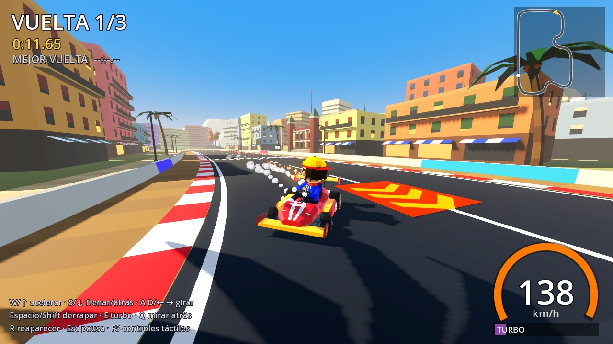
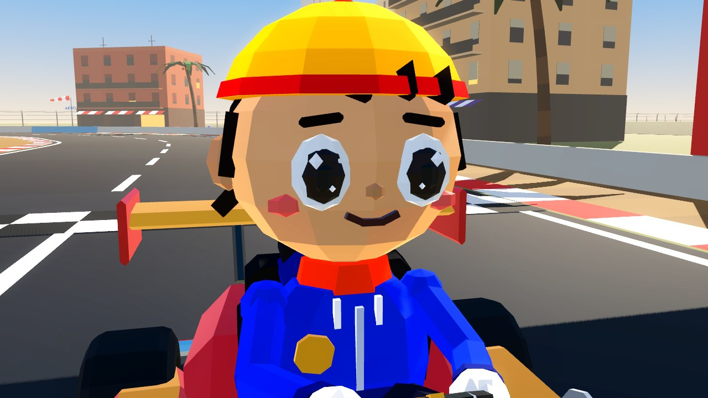
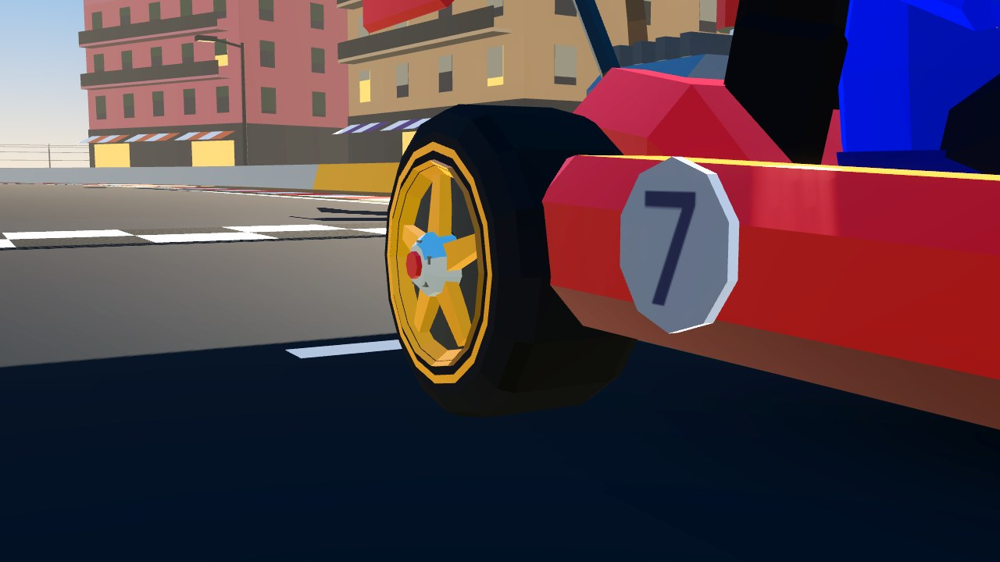
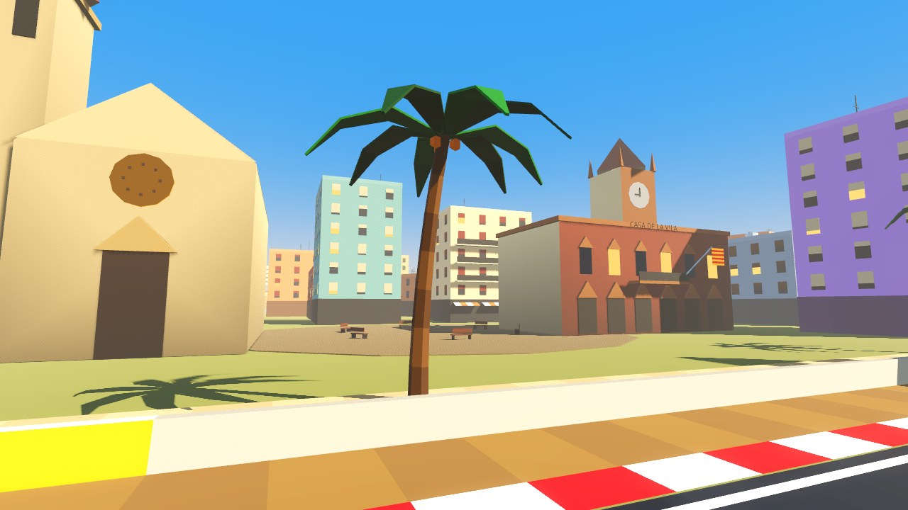
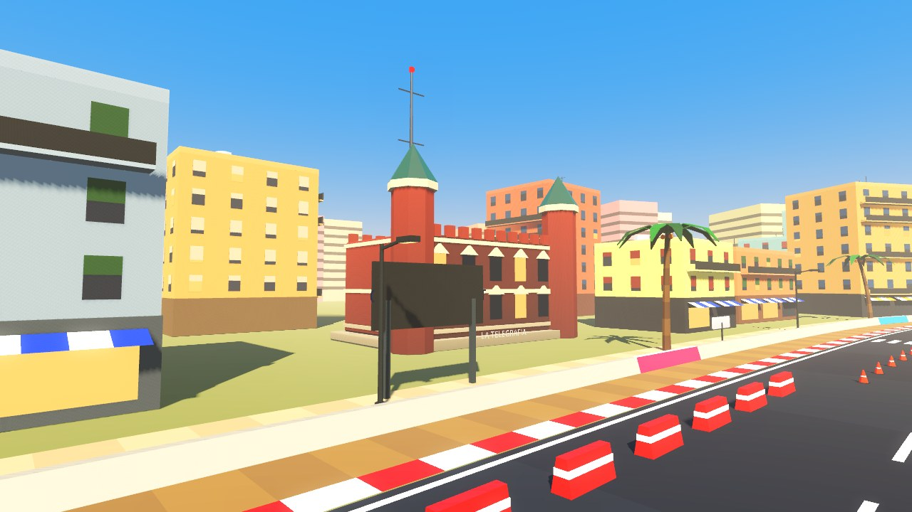
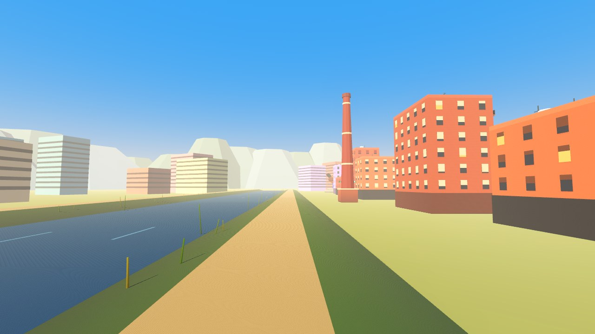
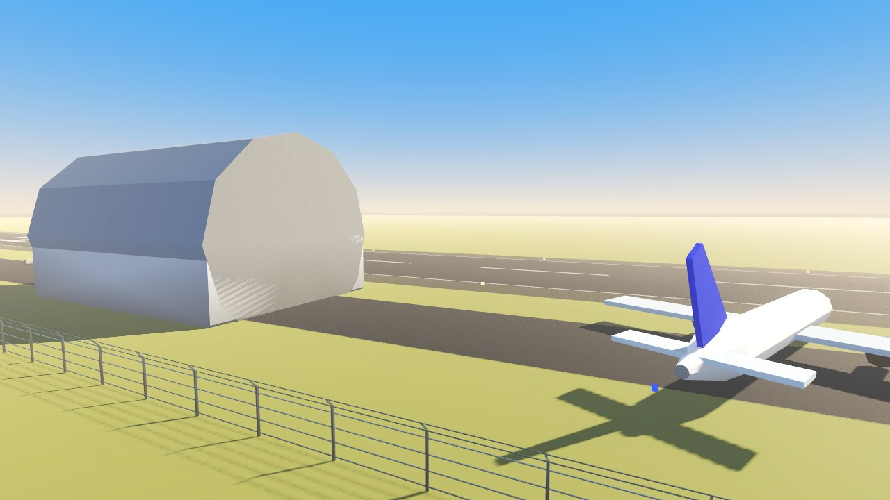

# Versión 0.2: pulido de conducción, gráficos y El Prat

Objetivo de esta entrega: mejorar la base antes de añadir más personajes o circuitos.
Sigue habiendo **un circuito, un kart y un piloto**.

| Delante | Detrás |
|---|---|
|  |  |
|  |  |

| Turbo | Mirar atrás |
|---|---|
|  |  |

## 1. Conducción

**Qué cambia al conducir**

- **Volante con tres velocidades** (teclado y botones): girar (`steer_press_rate`), soltar
  (`steer_release_rate`, vuelve al centro en menos de 0,15 s) y cambiar de lado
  (`steer_reverse_rate`, el más rápido, para corregir). Con stick analógico la respuesta es
  directa, sin filtros.
- **Derrape progresivo**: al entrar, el ángulo de deslizamiento y el giro crecen durante
  `drift_entry_time` (0,3 s) en vez de aparecer de golpe. Se parte del ángulo que ya llevara
  el kart, así que no hay saltos.
- **Contravolante real**: durante el derrape, girar hacia la curva la **cierra** (más ángulo,
  más giro, el mini-turbo carga más rápido) y girar hacia fuera la **abre** (menos ángulo,
  menos giro) **sin salir del derrape**.
- **Sin ayudas**: nada gira el kart por ti, nada lo alinea con la carretera y nada frena antes
  de las curvas. Con gas a fondo en curva el kart conserva el 100 % de su velocidad. La única
  pérdida es el rozamiento al soltar el acelerador (`coast_decel`), que no es un freno automático.
- **Reaparición segura**: si pulsas `R` junto a una isleta o las obras, reapareces en el carril libre.

**Parámetros editables.** Todo sigue siendo `@export` y se ajusta en el inspector del nodo
`Kart`, ahora agrupado en Motor, Dirección, Derrape, Turbo, Fuera de pista y Choques.
Se han añadido `accel_falloff`, `reverse_accel`, `full_steer_speed`, `steer_press_rate`,
`steer_release_rate`, `steer_reverse_rate`, `corner_speed_keep`, `drift_entry_time`,
`drift_slip_min`, `drift_slip_max`, `drift_slip_rate`, `drift_charge_into`, `wall_speed_loss`
y `wall_bounce`.

**Pruebas nuevas** (`tests/physics_tests.gd`, ahora con 23 en total):

| Prueba | Resultado medido |
|---|---|
| Giro a la izquierda (1 s a fondo) | 1,06 rad, 11,2 m a la izquierda |
| Giro a la derecha (1 s a fondo) | 1,06 rad, 11,2 m a la derecha |
| Simetría izquierda/derecha | diferencia 0,0000 rad / 0,000 m |
| Sin freno automático en curva | conserva el 100 % de la velocidad |
| Al soltar, el volante vuelve al centro | en menos de 0,15 s |
| Sin autocorrección tras soltar | 0,00000 rad de giro en 1 s |
| Derrape progresivo: el ángulo crece | 0,06 → 0,25 → 0,48 rad (0,05 s / 0,17 s / 0,52 s) |
| Derrape progresivo: el giro crece | 1,31 → 2,50 rad/s |
| Sin saltos bruscos | cambio máximo por fotograma dentro del límite |
| Contravolante abre la curva | giro cerrar 2,52 / neutro 1,55 / contravolante 0,58 rad/s |
| Contravolante reduce el ángulo | 0,48 / 0,32 / 0,16 rad |
| Con contravolante se mantiene el derrape | sí |

## 2. Calidad visual

**Kart, rehecho desde cero**
- Carrocería esculpida por secciones con chaflanes (morro afilado, cintura estrecha, pontones
  con toma de aire, cola elevada), franjas de carreras y dorsal en el morro y los laterales.
- Alerón trasero con perfil de ala y derivas, alerón delantero, parachoques tubular cromado,
  motor con aletas, filtro de admisión rojo y doble escape cromado.
- Asiento baquet con reposacabezas y volante de verdad (aro, radios, centro), que gira.
- **Ruedas**: neumático con hombros redondeados y banda de rodadura con dibujo, franja de
  color en el flanco, llanta de 5 radios con plato hundido, labio, tuercas y tapacubos, y
  pinza de freno roja. Las traseras son más anchas.
- **Materiales separados** (`materials/`): pintura con brillo y borde iluminado, goma mate,
  metal, cromo, piel y tela. Antes todo era un único material plano.

**Piloto chibi**
- Cabeza grande (proporción chibi) con mandíbula suave, ojos con blanco, iris, pupila y dos
  brillos, cejas, nariz, mofletes y pelo por mechones.
- Gorra hacia atrás con ribete, sudadera con capucha, cordones, cremallera y parche, bufanda
  naranja, vaqueros y zapatillas con suela de color.
- **Brazos articulados** (hombro, codo y mano) que siguen al volante cuando gira.

**Animaciones**
- Suspensión con muelle: rebota al aterrizar del saltito o al chocar. Cabecea al frenar y
  con el turbo, y se balancea según la fuerza lateral.
- El piloto se inclina en las curvas, respira en parado, mira hacia la curva y se gira de
  verdad al **mirar atrás**.
- Parpadeo aleatorio y expresiones: sonrisa normal o boca abierta con las cejas arriba al
  derrapar y con turbo.
- La bufanda ondea según la velocidad y las ruedas giran con contravolante visual en derrape.

**Iluminación y efectos** (`scripts/game/lighting.gd`, `scripts/kart/kart_effects.gd`)
- Sol de tarde mediterránea más bajo (sombras más largas y volúmenes marcados), luz de
  relleno fría desde el lado contrario, neblina cálida de costa, brillo suave en luces y
  saturación arcade. Sombras de 4096 px en PC y 2048 en móvil, con filtrado suave.
- Sombra de contacto bajo el kart, que se encoge al saltar.
- **Humo**: bocanadas 3D sombreadas que crecen y se desvanecen, al derrapar, frenar fuerte
  o patinar.
- **Chispas**: estelas alargadas orientadas a su velocidad y un destello en la rueda, del
  color del nivel de mini-turbo (azul, naranja o morado).
- **Turbo**: llamas cónicas parpadeantes en los escapes y partículas de fuego.

| Piloto | Rueda |
|---|---|
|  |  |

## 3. El Prat, menos genérico

Referencias reales investigadas y llevadas al low-poly, sin pretender ser réplicas exactas:

| Referencia | En el juego |
|---|---|
| **Pollastre Pota Blava**, raza Prat famosa por sus patas azules | Escultura gigante (≈14 m) en la primera curva |
| **La Telegrafia**, estación Marconi de Puig i Cadafalch (1911) | Edificio modernista de ladrillo con torrecillas y antena, en la calle norte |
| **Chimenea de la fábrica Torras Hostench** y mirador del **Parc del Riu** | Chimenea de ladrillo con anillos y torre mirador junto al río |
| **Río Llobregat** canalizado | Río con motas, paseo y cañas en el oeste |
| **Casa de la Vila** (neogótica, 1905) | Ayuntamiento con torre del reloj y senyera, en la nueva Plaça de la Vila |
| Parroquia y plaza del casco antiguo | Iglesia con campanario y rosetón en la misma plaza |
| **Mercat municipal** (noucentista) | Mercado con frontón y toldos en la avinguda |
| **Carxofa del Prat** | Escultura en la Plaça de la Carxofa (ya existía) |
| **Aeropuerto**: torre de control de 62 m con malla de hormigón hiperboloide y fanal octogonal | Torre con esa estructura, pista con luces de borde, de aproximación y PAPI, hangar, valla, manga de viento y avión estacionado |
| Aviones sobre el barrio | Un avión aterriza y otro despega, alineados con la pista y con luces de navegación |
| Señalización catalana | Pórtico azul "✈ Aeroport · C-31 Castelldefels" tras la salida y placas azules de calle |

| | |
|---|---|
|  |  |
|  |  |
|  |  |

Además, las vallas publicitarias se han adaptado al barrio ("Pollastre Pota Blava",
"Carxofa del Prat", bar de esmorzars) y los bloques de relleno ya no tapan los monumentos.

**Lo inventado.** La escultura de la gallina, la posición relativa de los edificios y los
nombres de las calles junto al circuito son libertades de diseño. El trazado no reproduce
calles reales.

## 4. Android

- **APK de prueba compilado automáticamente** en GitHub Actions (`.github/workflows/android.yml`)
  y publicado en <https://github.com/Erre84/Super-Barrio-Kart-3D./releases/tag/apk-prueba>.
- Manifiesto verificado en el APK generado: Android 7.0+ (minSdk 24), destino SDK 35,
  OpenGL ES 3.0, orientación horizontal, arm64.
- Clave de depuración fija, para que cada APK nuevo se instale encima del anterior.
- Calidad reducida automáticamente en móvil (sombras más pequeñas y más cortas).
- Instrucciones de instalación: [`docs/ANDROID.md`](ANDROID.md).

## Coste de render (medido)

| | v0.2 |
|---|---|
| Triángulos de kart + piloto | 6.501 |
| Triángulos de toda la escena | ≈117.000 |
| Llamadas de dibujo por fotograma (con sombras) | ≈270 |
| Memoria de vídeo | ≈73 MB |

Son cifras razonables para un móvil de gama media, pero **no se han medido los FPS en un
dispositivo real**.

## Qué sigue pendiente

- **Probar a mano**: nadie ha conducido todavía con teclado, mando ni pantalla táctil. Las
  pruebas automáticas garantizan el comportamiento (simetría, contravolante, sin ayudas),
  pero no si se *siente* bien. Los valores se ajustan en el inspector.
- **Probar el APK en un móvil real**: rendimiento, tamaño de los botones y calentamiento.
- **Personajes de Super Barrio Kart v16**: el piloto sigue siendo provisional; hacen falta
  los diseños originales para adaptarlo.
- **Sonido**: motor, derrape, turbo, choques y aviones.
- **Rivales con IA, objetos y menú**: fuera del alcance de esta entrega, a propósito.
- **Modelos en Blender**: si se quiere ir más allá del low-poly generado por código, el
  siguiente paso sería exportar estos modelos a glTF y retocarlos a mano.
- El Label3D de algunos carteles lejanos se ve pequeño en pantallas de móvil.
