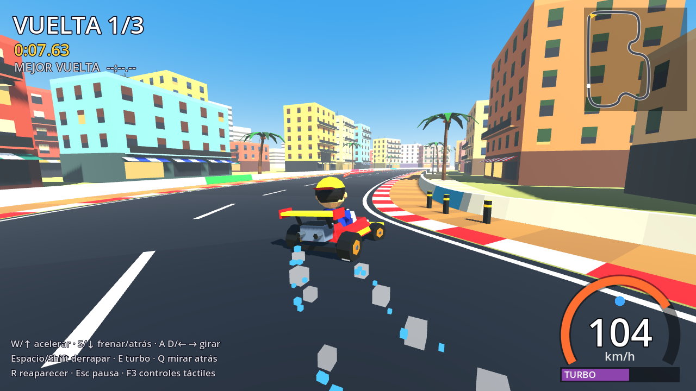
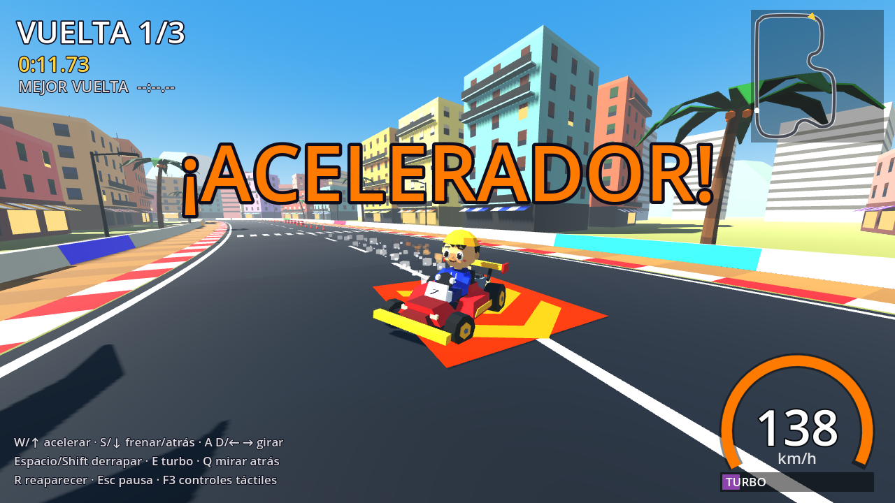
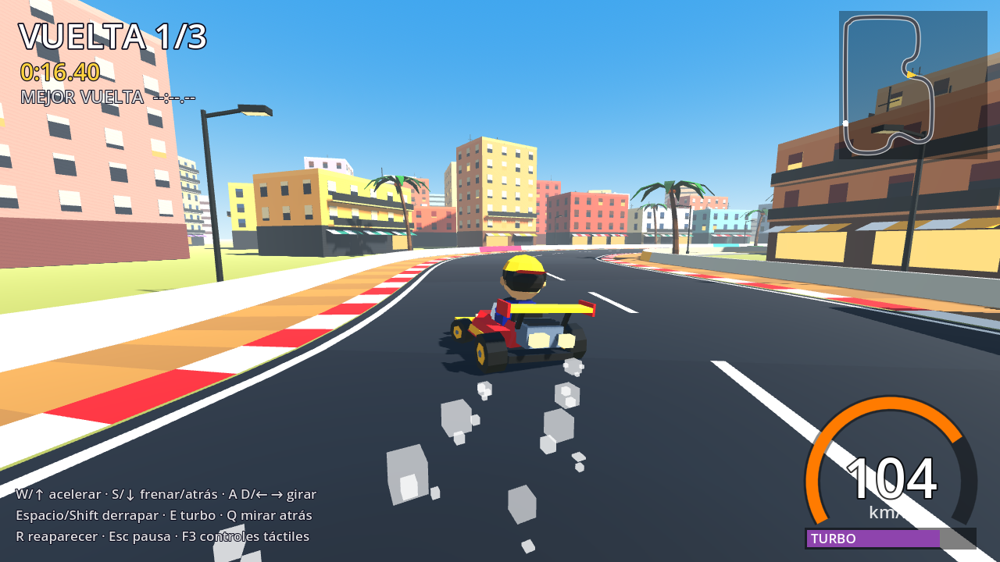
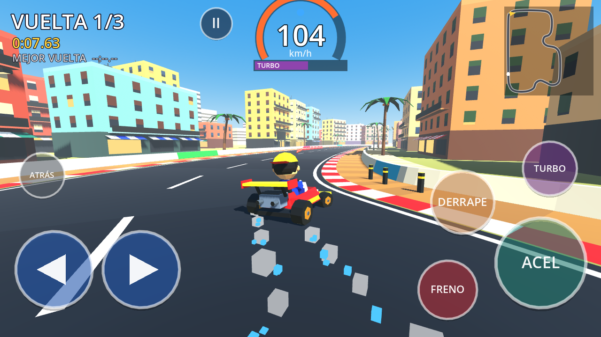
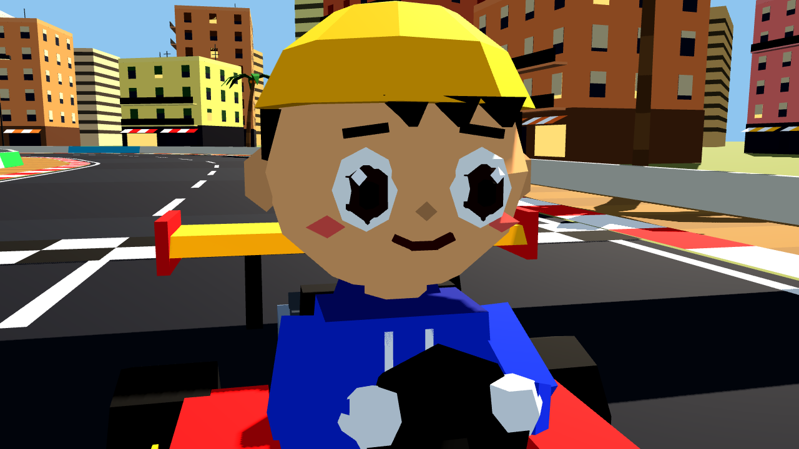
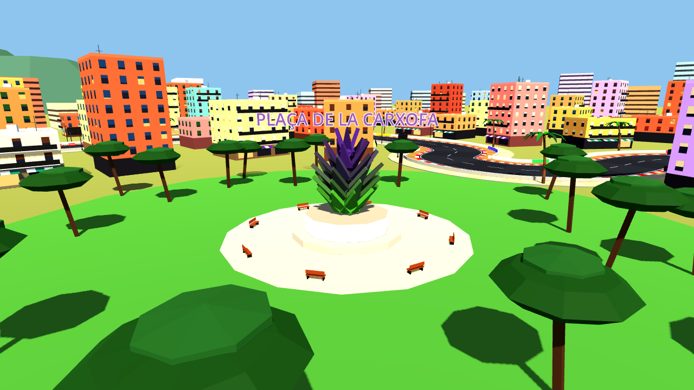

# Pruebas

## Pruebas automáticas

```bash
GODOT=/ruta/a/Godot_v4.5 ./tools/run_tests.sh          # compila + una vuelta automática
GODOT=/ruta/a/Godot_v4.5 ./tools/run_tests.sh --shots  # además, capturas en test_output/
```

También se ejecutan solas en GitHub Actions en cada *push* y *pull request*
(`.github/workflows/pruebas.yml`).

1. **Importación y compilación**: `godot --headless --import` no debe mostrar ningún
   `SCRIPT ERROR`.
2. **Vuelta automática**: `tests/autopilot.gd` conduce el kart pulsando las mismas acciones
   del `InputMap` que un jugador (`accelerate`, `steer_left`, `drift`...). Al terminar imprime
   un resumen JSON y falla si no completa una vuelta, no supera 80 km/h o no es capaz de
   ir marcha atrás. El piloto automático es deliberadamente torpe: roza muros y se sale en
   la "ese". Sirve para detectar roturas, no para medir lo bien que se conduce.
3. **Capturas** (`--shots`): necesitan una GPU o un servidor gráfico virtual (Xvfb).

## Resultados de la v0.6.3: girar más tras un choque y mini-turbo hacia delante

Peticiones: (1) tras chocar con la pared cuesta enderezar porque a poca velocidad gira poco;
(2) el impulso del mini-turbo debe ir hacia donde apunta el kart, no hacia donde se iba el derrape.

**Giro a baja velocidad** (`tests/low_speed_turn.gd`):

| | v0.6.2 | v0.6.3 |
|---|---|---|
| Desde parado, gas + volante a fondo, 0,5 s | 32° | **58°** |
| Ídem, 1 s | 85° | **118°** |
| Radio de giro a 20 km/h | 2,8 m | 2,1 m |
| Radio a 50 / 80 / 104 km/h | 7,9 / 26,9 / 38,2 m | igual |

Casi parado, acelerando o frenando, el kart puede pivotar (`pivot_steer`); por debajo de
~54 km/h gira hasta 1,45× más (`low_speed_steer`, `low_speed_steer_until`). A velocidad de
derrape no cambia nada.

**Dirección del mini-turbo** (`tests/turbo_direction.gd`): al saltar, toda la velocidad se
reorienta hacia el morro (`mini_turbo_redirect_keep`), se corta la inercia de giro del
derrape (`mini_turbo_yaw_keep`) y hay 0,25 s de agarre extra (`mini_turbo_straight_time`).

| Saltando a 14° de cruce y soltando el volante | v0.6.2 | v0.6.3 |
|---|---|---|
| Velocidad frente al morro (máx.) | 2,2° | 0,0° |
| Desplazamiento lateral en 0,6 s | 0,76 m | 0,49 m |
| Zigzag: cuánto se aparta de la recta | ±11,4 m | ±6,6 m |

Pruebas nuevas: el mini-turbo empuja hacia donde apunta el kart; casi parado gira mucho; a
alta velocidad el giro no se vuelve nervioso. 42/42 OK; vuelta del piloto automático 39,3 s,
0 reapariciones.

## Resultados de la v0.6.2: mini-turbo menos fuerte y más largo (prueba)

Petición: el turbo aún se ve un poco exagerado; que tenga menos fuerza pero dure un poco más.
Curva de un mini-turbo de nivel 3 (`tests/boost_curve.gd`, km/h cada 0,5 s al pisar):

| | Curva | Pico | Tiempo por encima de la punta |
|---|---|---|---|
| v0.6.1 | 64 → 104 → 127 → 127 → 112 → 104 | 127 km/h | 1,7 s |
| v0.6.2 | 62 → 96 → 121 → 121 → 121 → 121 → 106 | 121 km/h | 2,4 s |

Valores: `mini_turbo_accel` 11 → 7,5 m/s², `mini_turbo_speed` 1,12/1,17/1,22 → 1,08/1,12/1,16,
`mini_turbo_time` 1,0/1,3/1,6 → 1,6/2,0/2,5 s, `mini_turbo_kick` 1,0/1,4/1,8 → 0,6/0,9/1,2 m/s,
`boost_fade` 5 → 4. Golpe de cámara y vibración algo más suaves. Subida máx. 10,3 km/h por
0,1 s (antes 13,5). 39/39 OK; vuelta del piloto automático 39,9 s, 0 reapariciones.

## Resultados de la v0.6.1: velocidad mínima para derrapar

Matiz del usuario: yendo lento no se debe poder derrapar, pero tampoco hace falta ir a tope;
basta con ir un poco por encima de la velocidad media.

Zigzag manteniendo la velocidad (`tests/drift_speed_map.gd`, volante a fondo):

| Velocidad | v0.6 | v0.6.1 |
|---|---|---|
| 40 km/h | derrapa (19°) | **no derrapa** |
| 50 km/h | derrapa (25°) | **no derrapa** |
| 55 km/h | derrapa (26°) | **no derrapa** |
| 60 km/h | derrapa | derrapa (22°) |
| 65-104 km/h | derrapa | derrapa (26-28°) |

Al 75 % de volante empieza a 65 km/h. El empujón inicial del mini-turbo baja un poco más
(subida máx. 13,5 km/h por 0,1 s). Pruebas nuevas: no derrapa a 50 km/h ni a fondo; a 70 km/h
pasarse de giro sí derrapa. 39/39 OK; vuelta del piloto automático 39,8 s, 0 reapariciones.

## Resultados de la v0.6: zigzag en recta e impulso más suave

Petición tras probar la 0.5.1: que derrape en cuanto te pasas un poco de giro, para ir en
zigzag por las rectas encadenando mini-turbos, y que el impulso sea un poco menos rápido y
más constante.

| Medida | v0.5.1 | v0.6 |
|---|---|---|
| Zigzag en recta (75 % de volante, cambio cada 0,5 s) | 5 derrapes, **0 mini-turbos** | 8 derrapes, **7 mini-turbos** |
| Subida máxima de velocidad en 0,1 s con el mini-turbo | **38,6 km/h** (tirón) | **14,3 km/h** (empuje) |
| Pico del mini-turbo (nivel 1 / 3) | 127 / 144 km/h | 116 / 127 km/h |
| Giro que aún agarra a 104 km/h | 40 % | 35 % |
| Mini-turbos del piloto automático por vuelta | 6 | 10 |

Herramientas nuevas: `tests/drift_zigzag.gd` (tabla de zigzag por cantidad de volante y
ritmo). Pruebas nuevas: zigzag encadenado y empuje parejo. 36/36 OK.

## Resultados de la v0.5: el mini-turbo sale al volver a acelerar

Problema tras probar la 0.4: "cuando derrapo y vuelvo a acelerar, falta el impulso". Causa
encontrada con `tests/drift_flows.gd`, que prueba las formas naturales de salir de un derrape:
solo funcionaba **mantener el gas a fondo todo el derrape** y luego soltar y pisar. Si
soltabas el gas durante el derrape o al contravolantear (lo natural), el juego lo rechazaba.
Además el impulso era flojo (+18 % de punta) y casi no se notaba al salir lento.

| Forma de salir del derrape | v0.4 | v0.5 |
|---|---|---|
| Gas a fondo; al enderezar, suelta y pisa | turbo (104 → 123 km/h) | turbo (103 → 136 km/h) |
| Suelta en el derrape, pisa al enderezar | **nada** | turbo (59 → 136 km/h) |
| Suelta en el derrape, pisa mientras sale | **nada** | turbo (63 → 136 km/h) |
| Suelta al contravolantear, pisa al enderezar | **nada** | turbo (73 → 136 km/h) |
| Suelta al contravolantear, pisa mientras sale | **nada** | turbo (77 → 136 km/h) |
| No suelta nunca el gas | nada | nada (a propósito) |

**v0.5.1.** Segunda causa encontrada con `tests/drift_late_lift.gd`: si soltabas y pisabas
con el kart ya recto, solo valía hacerlo en los primeros ~0,6 s. Ahora el plazo es de 1,2 s
(medido: da turbo soltando hasta 0,9 s después de enderezar y pisando 0,13 s más tarde).

Siguen bloqueados: machacar el acelerador sin derrapar (0 turbos) y machacarlo en la ventana
(un solo turbo). El piloto automático consigue **6 mini-turbos en una vuelta** sin maniobra
programada (antes 1). 34/34 pruebas de física OK.

## Resultados de la v0.4: derrape accesible y conos (Godot 4.5 estable, Linux)

Tras probar la APK 0.3, el derrape resultaba demasiado exigente (un solo derrape en una
vuelta). Cambios y medidas:

- **Mapa de facilidad** (`tests/drift_ease_map.gd`, 20 combinaciones de velocidad y volante):
  ventanas de mini-turbo en **11 de 20**, frente a **1 de 20** en la v0.3. Con un 40 % de
  volante el kart sigue agarrando a cualquier velocidad, y eses suaves (50 %) a 80 km/h
  no derrapan (4,7° de deriva máx.).
- **Conos.** Antes el kart podía subirse a un cono como a una rampa y salir lanzado:
  **hasta 246 m** de altura medidos en la v0.3. Ahora el kart no choca físicamente con los
  conos (capas de colisión separadas): los detecta por cercanía y los lanza. Nueva prueba:
  se atropellan 6 conos de frente y de refilón a 100 km/h y el kart no sube nada (0,00 m).
- **Vuelta automática:** el piloto automático consigue un mini-turbo de nivel 3 **en una
  curva sin maniobra programada**. Entra pasado de velocidad, se cruza, contravolantea y,
  al soltar y pisar para controlar la velocidad, le sale el impulso.
- 31/31 pruebas de física OK.

## Resultados de la v0.3: derrape natural (Godot 4.5 estable, Linux)

30 pruebas de física con entrada inyectada fotograma a fotograma (`kart.input_override`),
todas en campo abierto o en recta, **sin depender de ninguna curva**:

```
OK  sin autocorrección de dirección — 0.00000 rad sin tocar el volante
OK  giro izquierda / derecha (60 %) — 0.75 rad / 0.75 rad, simétricos (0.0000)
OK  sin freno automático en curva — conserva 100% / 100%
OK  al soltar, el giro se detiene en <0,3 s (inercia de la carrocería)
OK  después sigue recto — 0.00007 rad en 1 s
OK  giro moderado a fondo: agarra — deriva máxima 0.6°
OK  volantazo en recta: pierde agarre y derrapa — 28.5°, derrape desde 0.35 s, 13.7 m/s laterales
OK  pérdida de agarre progresiva — 6.3° → 18.2° → 27.7° (0,25 / 0,5 / 0,75 s), máx. 0.92°/fotograma
OK  a baja velocidad no derrapa — 44 km/h a fondo: 0.0°
OK  derrape simétrico izquierda/derecha — 32.3° / 32.3°, diferencia 0.000°
OK  conserva inercia lateral al soltar el volante — sigue deslizando 1.52 s
OK  contravolante endereza mucho antes — 0.77 s frente a 1.52 s
OK  volante a fondo: derrape sostenido y controlable — 32.5°–37.3° durante 2 s
OK  frenar a fondo derrapando: trompo (92°) y derrape anulado, sin turbo
OK  enderezar + soltar y pisar = mini-turbo — 103 → 123 km/h
OK  pisar fuera de la ventana no da impulso
OK  sin soltar el acelerador no hay impulso
OK  volantazo de 0,25 s: derrape demasiado corto, no cuenta
OK  machacar el acelerador 3 s sin derrapar — 0 mini-turbos
OK  machacar el acelerador en la ventana — 1 solo mini-turbo
OK  encadenar derrapes en recta (der → izq → der) — 3 mini-turbos, 123 km/h al final
OK  marcha atrás, punta 104 km/h, turbo 138 km/h, muros, choque, conos, tierra
```

**Vuelta automática.** El piloto automático ya no tiene botón de derrape: controla la
velocidad según la curva que viene y contravolantea si se cruza. En la recta de salida hace
la maniobra completa (volantazo → contravolante → suelta y pisa) y consigue un mini-turbo
de nivel 2. Vuelta en ~37 s, 0 reapariciones.

**Sonido.** Se ha verificado exportando los sonidos sintetizados a WAV y analizando su
espectro: el chirrido se centra en 1,75 kHz, el motor en 147 Hz (audible en altavoces de
móvil) y nada satura. **No se ha escuchado en un dispositivo.**

**Táctil analógico.** Se han simulado toques en el botón ▶: en el borde interior gira al 45 %,
en el centro al 73 % (agarra) y en el borde exterior al 100 % (derrapa a alta velocidad).

### Lo que la v0.3 no ha podido probar
- **Si es divertido a mano.** Es lo que más importa y no se puede medir aquí. Los valores
  medidos son coherentes (entrada progresiva, derrape sostenible, contravolante útil y
  trampas bloqueadas), pero el ajuste fino requiere jugar.
- **Anchura de la calle.** Un derrape válido en recta desplaza el kart unos 8 m de lado. Cabe
  en la calle (24 m entre muros) en zigzag, pero hay que comprobar jugando si resulta cómodo
  o conviene ensanchar las rectas.

## Resultados de la v0.2 (Godot 4.5 estable, Linux)

| Prueba | Resultado |
|---|---|
| Importación y compilación de todos los scripts | ✅ sin errores |
| 23 pruebas de física (`tests/physics_tests.gd`) | ✅ 23/23 |
| Vuelta completa con el piloto automático | ✅ 29,7 s, 0 reapariciones, 4 roces |
| Render real con Compatibility (OpenGL 3.3 por software) | ✅ capturas en `docs/img/v0.2/` |
| APK de Android compilado en GitHub Actions | ✅ 27,9 MB, se descarga de la release `apk-prueba` |
| Manifiesto del APK | ✅ minSdk 24 (Android 7.0), targetSdk 35, OpenGL ES 3.0, horizontal, arm64 |

**Pruebas de dirección nuevas en la v0.2:**

```
OK  giro a la izquierda — 1.06 rad, 11.2 m a la izquierda
OK  giro a la derecha — 1.06 rad, 11.2 m a la derecha
OK  izquierda y derecha simétricas — diferencia 0.0000 rad / 0.000 m
OK  sin freno automático en curva — conserva 100% / 100% de la velocidad con gas a fondo
OK  al soltar, el volante vuelve en <0,15 s — giro residual 0.0000 rad/s
OK  después sigue recto (sin autocorrección) — 0.00000 rad en 1 s
OK  derrape progresivo: el ángulo crece — 0.06 → 0.25 → 0.48 rad (0,05 s / 0,17 s / 0,52 s)
OK  derrape progresivo: el giro crece — 1.31 → 2.50 rad/s
OK  derrape sin saltos bruscos — cambio máximo por fotograma 0.0267 rad (límite 0.0272)
OK  contravolante abre la curva — giro cerrar 2.52 / neutro 1.55 / contravolante 0.58 rad/s
OK  contravolante reduce el ángulo — deslizamiento 0.48 / 0.32 / 0.16 rad
OK  con contravolante se mantiene el derrape
```

Se mantienen las 11 pruebas de la v0.1: sin autocorrección, marcha atrás, punta, turbo,
mini-turbo morado, muros, choque detectado, conos y tierra.

### Errores encontrados y corregidos en la v0.2

- El piloto automático se quedaba atascado contra una isleta y la reaparición podía dejar
  el kart encima de ella: ahora siempre se reaparece en el carril libre.
- La luz de relleno se dibujaba en el cielo como un "segundo sol" oscuro.
- El río quedaba enterrado bajo el suelo y los bloques lejanos se colocaban encima del aeropuerto.
- Los rótulos de los monumentos estaban girados del revés y no se leían.
- La suspensión podía volverse inestable si un fotograma tardaba mucho, como en un móvil
  lento; ahora se integra en pasos pequeños.
- Las llamas del turbo saturaban a blanco.
- Cada compilación del APK usaba una clave distinta, lo que obligaba a desinstalar para
  actualizar; ahora la clave de depuración es fija.

## Resultados de la v0.1 (histórico)

Comprobado en un entorno sin pantalla ni GPU, con Godot 4.5 oficial:

| Prueba | Resultado |
|---|---|
| Importación del proyecto, compilación de todos los scripts | ✅ sin errores |
| 11 pruebas de física (`tests/physics_tests.gd`) | ✅ 11/11 |
| Vuelta completa con el piloto automático (física real a 60 Hz) | ✅ ver resumen abajo |
| Render real con el renderizador Compatibility (OpenGL 3.3, Mesa llvmpipe por software) | ✅ capturas en `docs/img/` |
| Marcha atrás | ✅ alcanza la velocidad máxima de marcha atrás (−9 m/s) |
| Derrape y mini-turbos | ✅ el piloto automático encadena varios mini-turbos por vuelta |
| Turbo, pads aceleradores y salida perfecta | ✅ se disparan durante la vuelta |
| Choques con muros | ✅ el kart rebota y pierde velocidad, sin atravesar |

**Pruebas de física** (`tests/physics_tests.gd`):

```
OK  sin autocorrección de dirección — giro sin tocar el volante: 0.00000 rad
OK  marcha atrás — velocidad hacia delante -9.0 m/s
OK  velocidad punta — 104 km/h
OK  turbo supera la punta — 138 km/h con turbo
OK  entra en derrape
OK  mini-turbo morado (nivel 3)
OK  al soltar sale el mini-turbo — ["mini3"]
OK  el muro no se atraviesa — se queda a 10.5 m del eje (muro a 12 m), lanzado a 108 km/h con turbo
OK  se detecta el choque
OK  los conos salen volando — el cono se movió ~8 m
OK  la tierra frena — 57 km/h fuera de pista
```

**Vuelta automática** (resumen impreso por `tests/autopilot.gd`):

```
vuelta: 31.8 s   punta: 138 km/h (con turbo)   choques con muro: 7
mini-turbos: 9   turbos: 4   pads: 2   salida perfecta: sí
fuera de pista: 0 s   reapariciones: 0   marcha atrás: -9 m/s
```

**Capturas reales del juego** (renderizador Compatibility):

| | |
|---|---|
|  |  |
|  |  |
|  |  |

#### Errores encontrados y corregidos gracias a estas pruebas

- Los colores de vértice salían con la gamma mal (todo casi blanco): ahora se escriben en
  espacio lineal.
- El derrape hacía perder casi toda la velocidad y nunca pasaba del nivel azul: se cambió a
  un modelo arcade que conserva la velocidad con un ángulo de deslizamiento fijo.
- La normal de los muros llegaba invertida y el choque no se registraba (ni frenaba ni hacía
  vibrar la cámara).
- La capa de botones táctiles medía 0×0 píxeles y no se veía; después, los botones se
  solapaban. Ambas cosas corregidas.
- Los bloques de pisos junto al circuito no se colocaban; el dorsal salía del revés; la cara
  del piloto parecía llevar gafas de sol.

## Lo que NO se ha podido probar aquí

Sé claro con esto antes de dar la versión por buena:

- **Sensación de manejo con manos humanas.** Nadie ha conducido todavía con teclado ni
  mando: solo el piloto automático. Los valores de giro, agarre y derrape son un primer
  ajuste razonable; es muy probable que haya que retocarlos jugando
  (están todos en el inspector del nodo `Kart`).
- **Mando físico.** El mapeo está definido (Xbox/PlayStation estándar vía SDL), pero no se
  ha conectado ningún mando real.
- **Android en un móvil real.** El APK se compila y su manifiesto es correcto, pero **no se
  ha instalado en ningún teléfono**: no se ha comprobado que arranque, ni los FPS, ni el
  tacto real de los botones.
- **Rendimiento real.** El render se ha hecho por software (muy lento); no hay medidas de
  FPS en un PC con GPU ni en un móvil. Toda la ciudad son unas pocas mallas grandes; si un
  móvil modesto va justo, lo primero sería reducir sombras y edificios lejanos.
- **Windows/macOS.** Solo se ha ejecutado en Linux.
- **Sonido.** No hay audio en esta versión.

## Lista de comprobación manual (para ti)

**PC, teclado**
- [ ] El juego arranca, se ve la cuenta atrás 3-2-1-¡YA!.
- [ ] Acelerar justo antes del ¡YA! da "¡Salida perfecta!".
- [ ] `A`/`D` giran el kart y, al soltar, el kart sigue recto (no se endereza solo hacia la calle).
- [ ] `S` frena y, parado, va marcha atrás.
- [ ] `Espacio` + giro: saltito, derrape, chispas azul → naranja → morado; al soltar, turbo.
- [ ] El derrape entra suave (no da un latigazo) y se asienta en unas décimas de segundo.
- [ ] Durante el derrape, girar hacia fuera (contravolante) abre la curva **sin** salir del derrape.
- [ ] Girar a la izquierda y a la derecha se siente igual.
- [ ] Al soltar la dirección el kart sigue recto y no busca la carretera por su cuenta.
- [ ] Humo de neumáticos al derrapar y al frenar fuerte.
- [ ] `E` con la barra llena: ¡TURBO! y llamas por los escapes.
- [ ] `Q` mantiene la vista hacia atrás.
- [ ] Chocar con un muro frena y hace vibrar la cámara; los conos salen volando.
- [ ] Salirse a la tierra frena y levanta polvo.
- [ ] Contador de vueltas 1/3 → 2/3 → ÚLTIMA VUELTA → ¡META!.
- [ ] `R` devuelve el kart a la pista. `Esc` pausa; "Reiniciar carrera" funciona.

**Mando**
- [ ] Stick izquierdo gira de forma progresiva (analógica).
- [ ] Gatillos aceleran/frenan; `RB`/`LB` derrapan; `X` turbo; `Y` mirar atrás; `Start` pausa.

**Android** (instalación: [`ANDROID.md`](ANDROID.md))
- [ ] El APK se instala y el juego arranca.
- [ ] Va fluido (si no, apunta el modelo del móvil).
- [ ] El juego arranca en horizontal y a pantalla completa.
- [ ] Los botones táctiles aparecen solos y se pueden pulsar varios a la vez
      (acelerar + girar + derrapar).
- [ ] Se puede deslizar el pulgar entre ◀ y ▶ sin levantarlo.
- [ ] El botón **II** pausa.
